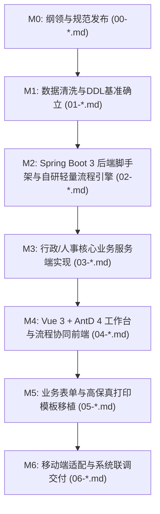

# 现代企业协同办公系统（OA-Suite Modernization）研发总纲领与实施任务书

> **文档标识**：`00-项目研发总纲领与实施任务书.md`  
> **基准包名**：`com.graddu.oa`  
> **工作空间**：`E:\OA\oa-suite\oa-dev`  
> **文档存放目录**：`E:\OA\oa-suite\oa-dev\docs`  
> **编制日期**：2026-10-27  
> **状态**：正式发布 / 纲领性文件  

---

## 1. 项目背景与重构愿景

### 1.1 现状与重构动因
原 `oa-suite` 项目构建于 2020 年前后，其核心价值在于深度沉淀了贴合国内企业实际运转的**全套行政、人事、审批单据与轻量动态工作流**业务模型。然而，原系统存在不可调和的底层缺陷：
1. **架构安全漏洞**：采用 `xmysql` 在前端直接通过 REST API 读写底层 MySQL 数据库表，业务逻辑和审批流转完全由浏览器端 JavaScript 驱动，缺乏服务端鉴权与事务保证，存在严重的越权篡改与并发脏写隐患。
2. **技术栈依赖断代**：前端强依赖 `node-sass 4.13`、`webpack 2/4`、`Vue 2.6`，在现代 Node.js 18+ 环境下无法正常构建；后端基于旧版 JeecgBoot 2.1.3 (Spring Boot 2.1.3 + Java 8 + Shiro 1.4)，充斥已知 CVE 漏洞。

### 1.2 重构核心目标
**“取其业务精髓，建其现代根基”**：
- **服务端收口与现代化**：使用现代最成熟且高性能的 **Spring Boot 3 + Java 17/21 + Sa-Token + MyBatis-Plus** 体系，将前端裸写数据库的逻辑全面收拢为具备严密事务控制 (`@Transactional`)、数据脱敏、数据校验的服务端业务体系。
- **前端体验升级**：采用 **Vue 3.4+ + TypeScript + Vite 5 + Ant Design Vue 4.x + Pinia**，复刻原工程优雅的表单交互与特色高保真纸质打印模板。
- **规范工程交付**：以 `com.graddu.oa` 为统一顶级包名，全周期技术与业务设计文档统一按 `00-*.md`, `01-*.md` 规范严格归档于 `oa-dev/docs`。

---

## 2. 核心资产提炼与矩阵规划

| 业务板块 | 原系统资产映射 | 提炼价值点 | 现代重构策略 |
| :--- | :--- | :--- | :--- |
| **轻量审批引擎** | `workflow.js`, `manage.js`, `bs_approve*`, `pr_log*` | 支持动态审批人、自由加签、会签、知会、历史日志归档 | 用 Java 重构为轻量状态机服务，免去复杂 BPMN 引擎开销 |
| **人事考勤管理** | `bs_leave`, `bs_attendance*`, `bs_overtime`, `bs_egress` | 请假、外出、加班单据，打卡记录，月度考勤统计 | 规范表结构，服务端增加跨天计算与请假时长自动校验 |
| **行政公文用印** | `bs_seal_normal`, `bs_seal_contract`, `bs_redhead`, `bs_record_borrow` | 公章/合同/申报用印审批，红头公文下发，档案借阅 | 沉淀统一的审批单据基类，集成文件附件与流程挂载 |
| **高保真单据打印** | `AttendancePrint.vue`, `LeavePrint.vue`, `ExistPrint.vue` | 带有审批意见、手写签名位、部门主管章的标准纸质格式 | 基于 Vue 3 + CSS Print 进行现代响应式与高保真打印还原 |
| **移动端应用** | `oa-vuchat-service-master` | 仿钉钉/微信移动端打卡定位、移动待办/已办详情 | 基于现代响应式 H5 或 Uni-app 渐进式适配 |

---

## 3. 总体技术架构设计

```
                    ┌──────────────────────────────────────────────┐
                    │       Web 客户端 (Vue 3 + Ant Design Vue 4)   │
                    │       移动端 (Vue 3 + Vant 4 / Uni-app)      │
                    └──────────────────────┬───────────────────────┘
                                           │ HTTPS / RESTful API
                                           ▼
┌─────────────────────────────────────────────────────────────────────────────────────────┐
│                           Spring Boot 3 核心后端 (com.graddu.oa)                         │
│                                                                                         │
│  ┌───────────────────────┐ ┌───────────────────────┐ ┌───────────────────────────────┐  │
│  │    oa-framework       │ │     oa-workflow       │ │          oa-business          │  │
│  │  - Sa-Token 鉴权/路由 │ │  - 轻量流程定义与实例 │ │  - 行政模块 (用印/公文/借阅) │  │
│  │  - 全局异常与统一响应 │ │  - 待办/已办/知会任务 │ │  - 人事模块 (请假/考勤/加班) │  │
│  │  - MyBatis-Plus 审计  │ │  - 自由加签/会签算法  │ │  - 协同模块 (公告/日志/工作台)│  │
│  └───────────────────────┘ └───────────────────────┘ └───────────────────────────────┘  │
│                                           │                                             │
│  ┌────────────────────────────────────────┴──────────────────────────────────────────┐  │
│  │                               持久层 & 中间件服务                                 │  │
│  │    MySQL 8.x (InnoDB, utf8mb4)  │  Redis 7.x (缓存/会话)  │  MinIO/本地 (附件存储)  │  │
│  └───────────────────────────────────────────────────────────────────────────────────┘  │
└─────────────────────────────────────────────────────────────────────────────────────────┘
```

### 3.1 后端工程结构规划 (`com.graddu.oa`)
```
oa-backend/
└── src/main/java/com/graddu/oa/
    ├── common/                 # 通用基础包
    │   ├── api/                # 统一响应结构 R<T>、PageResult
    │   ├── constant/           # 系统与业务常量
    │   ├── enums/              # 状态码、流程状态枚举
    │   └── exception/          # 业务自定义异常及全局异常捕获
    ├── framework/              # 基础组件支撑
    │   ├── config/             # Spring/Web/MyBatis/Redis 配置
    │   ├── security/           # Sa-Token 鉴权与上下文拦截
    │   └── mybatis/            # 审计字段自动填充 (create_time, update_by 等)
    ├── module/
    │   ├── system/             # 系统底层 (用户、角色、部门、字典、岗位)
    │   │   ├── controller/
    │   │   ├── service/
    │   │   ├── entity/
    │   │   └── mapper/
    │   ├── workflow/           # 自研轻量工作流引擎 (重构核心)
    │   │   ├── core/           # 流程状态机调度器 (加签/会签/回退/知会)
    │   │   ├── entity/         # ProcessInstance, ProcessTask, ProcessLog
    │   │   └── service/
    │   └── business/           # 业务单据领域
    │       ├── administrative/ # 行政模块 (印章、公文、借阅)
    │       ├── attendance/     # 考勤与人事模块 (请假、外出、考勤记录)
    │       └── workplace/      # 工作台统计、待办已办聚合
    └── OaApplication.java      # 启动类
```

### 3.2 前端工程结构规划 (`oa-frontend`)
```
oa-frontend/
├── src/
│   ├── api/                    # 强类型 API 接口按模块组织
│   ├── assets/                 # 静态资源与样式
│   ├── components/             # 通用业务组件 (人员选择器、流程步骤条、打印容器)
│   ├── layouts/                # 基础框架布局 (侧边栏、顶部菜单、面包屑)
│   ├── router/                 # 动态路由与权限守卫
│   ├── store/                  # Pinia 状态管理 (user, permission, app)
│   ├── utils/                  # 请求工具、打印工具、格式化
│   └── views/                  # 业务页面
│       ├── dashboard/          # 工作台 (待办/已办/公告/统计卡片)
│       ├── workflow/           # 流程详情、审批弹窗、流转记录
│       ├── administrative/     # 用印申请、公文管理、档案借阅
│       ├── attendance/         # 请假申请、外出打卡、考勤排班
│       └── system/             # 组织架构、用户角色、字典维护
```

---

## 4. 实施任务与里程碑规划 (Roadmap)

整个现代化改造计划分为六个递进里程碑：



### 任务阶段一览表

| 序号 | 里程碑阶段 | 核心任务内容 | 交付产物与文档 |
| :---: | :--- | :--- | :--- |
| **00** | **总纲领与规范确立** | 明确建设目标、架构全景图、目录规划、开发规范 | `00-项目研发总纲领与实施任务书.md` |
| **01** | **数据层清洗与标准化** | 剥离无用表，规范化主键、字段类型、统一审计字段，重构业务视图与数据字典 | `01-数据模型清洗与数据库基准规范.md`<br>初始化 DDL 脚本 `schema.sql` |
| **02** | **后端脚手架与流程引擎** | 构建 Spring Boot 3 + Sa-Token 骨架，将原前端加签/会签/知会/历史归档算法重写为服务端事务服务 | `02-后端工程脚手架与流程引擎设计.md`<br>`oa-backend` 基础模块与流程服务 |
| **03** | **行政与考勤业务服务端** | 完成请假、考勤、用印（公章/合同/申报）、档案借阅等单据 CRUD 与流程挂钩 | `03-行政与人事业务接口实现文档.md`<br>业务领域 API 与单元测试 |
| **04** | **Vue 3 前端脚手架与工作台** | 搭建 Vite 5 + Ant Design Vue 4 框架，实现基于 Sa-Token 的权限路由与工作台待办/已办列表 | `04-前端架构与工作台审批开发文档.md`<br>`oa-frontend` 基础管理工程 |
| **05** | **表单移植与高保真打印** | 移植各类复杂审批表单，还原高保真带盖章位、手写签名区的纸质打印样式 | `05-业务表单与打印排版移植文档.md`<br>业务 View 组件与打印模块 |
| **06** | **移动端与系统总体验收** | 适配移动端 H5 打卡/审批流程，端到端完整链路联调与自动化打包部署脚本 | `06-移动端与集成测试交付文档.md`<br>全套 Docker Compose 一键启动包 |

---

## 5. 开发规范与质量底线

### 5.1 命名与包名约定
- **Java 包名**：统一以 `com.graddu.oa` 为根包。
- **数据库规范**：
  - 核心业务表统一采用 `oa_` 前缀（如 `oa_leave`, `oa_seal_apply`, `oa_proc_inst`）。
  - 每张业务表必须具备标准字段：
    - `id`: `BIGINT UNSIGNED` / 雪花算法 ID（主键）。
    - `create_by`: `VARCHAR(64)`（创建人工号/用户名）。
    - `create_time`: `DATETIME`（创建时间）。
    - `update_by`: `VARCHAR(64)`（更新人）。
    - `update_time`: `DATETIME`（更新时间）。
    - `is_deleted`: `TINYINT DEFAULT 0`（逻辑删除标志）。

### 5.2 流程处理质量准则
- 严禁任何绕过流程引擎直接修改业务表审批状态（`status`）的行为。
- 所有流程状态迁移必须处于 `@Transactional(rollbackFor = Exception.class)` 强事务中，同时写入流程日志 `oa_proc_log`。
- 敏感接口（如审批同意、退回、加签）必须在后端校验当前操作人是否为任务指派人（防止水平越权）。

### 5.3 文档落档准则
- 后续每一个里程碑实施前或实施完毕，必须同步输出标准 Markdown 文档并存放于 `E:\OA\oa-suite\oa-dev\docs/`。
- 编号严格遵循递增命名：`01-*.md`、`02-*.md` 等，确保整个重构过程透明可溯。

---
*(本文档为项目总指导纲领，后续开发及子模块设计需严格遵照本文档设定的技术方向与规范执行。)*
