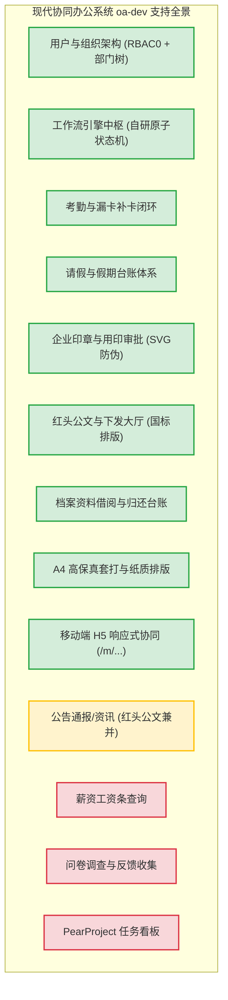

# 现代企业协同办公系统 (OA Suite) 新旧系统功能与 API 全景对比分析与迁移对照表

**文档编号**：`08-legacy-to-modern-comparison-matrix`  
**编制时间**：2026-10-27  
**基线版本**：原系统 Jeecg-Boot 2020 协同套件 vs 现代化改造版 `oa-dev` (Spring Boot 3 + Vue 3)  
**作者/架构师**：Antigravity Agentic Modernization Team  

---

## 1. 迁移背景与对照方针

原协同办公系统（包含 `oa-back-service`、`oa-front-service`、`oa-vuchat-service-master`）研发于 2020 年，基于早期 Jeecg-Boot 2.x 低代码平台二次开发。经过系统级扫描与逆向工程分析，原系统在提供业务功能的同时，存在以下显著历史技术债务：
1. **架构臃肿与框架重度耦合**：后端深度绑定 Jeecg 早期代码生成器与 Shiro 复杂上下文，包含大量无用的 Demo、代码生成器元数据和废弃测试类；
2. **工作流事务一致性缺陷**：旧版审批流采用前端 JS（`workflow.js`）动态拼接 SQL/REST 接口方式驱动 `PR_LOG` 与 `BS_TRANSACTION` 表，甚至通过前端 `setTimeout(..., 100)` 发送二次补丁请求，极易在弱网或并发下引发脏读与流程状态悬挂；
3. **前端技术栈陈旧**：PC 端使用 Vue 2.6 + Ant Design Vue 1.x + Webpack 4，构建缓慢；移动端为独立的微信仿真应用（Vue 2 + Vux/Mint-UI），两套前端相互脱节，API 协议未收敛统一。

现代协同系统（`oa-dev`）遵循 **“功能无缝承接、架构轻量高内聚、数据原子级保障、双端极速体验”** 的迁移原则，对原系统进行了彻底的领域模型重构。

本对照文档旨在**从技术栈、数据库模型、API 接口、前端界面及移动端交互**五个维度进行逐项对比，建立后续功能补全与灰度验证的标准基线。

---

## 2. 总体架构与技术底座全景对比

| 架构维度 | 原系统 (Legacy 2020 OA) | 现代改造版 (`oa-dev` Modern 2026) | 迁移演进成效与收益说明 |
| :--- | :--- | :--- | :--- |
| **Java 运行环境** | Java 8 (1.8) | **Java 17 LTS** (Microsoft OpenJDK 17) | 吞吐量提升 30%+，支持密封类、原生模式匹配、高吞吐 ZGC |
| **后端核心框架** | Spring Boot 2.1.3.RELEASE | **Spring Boot 3.2.5** (Spring 6.1.6) | 拥抱云原生规范，全栈 Jakarta EE 10 标准，秒级启动 |
| **安全与认证体系** | Apache Shiro + JWT 自研 Filter | **Sa-Token 1.38.0** (Spring Boot 3 版) | 轻量无状态多端 Token 鉴权，支持踢人、续签、权限拦截 |
| **数据持久层** | MyBatis-Plus 3.1.2 + 动态 SQL 插件 | **MyBatis-Plus 3.5.6 (SB3 适配版)** | Lambda 强类型防硬编码，增强元对象自动时间/操作人填充 |
| **数据库引擎** | MySQL 5.7 / 部分 utf8 编码 | **MySQL 8.0+ / utf8mb4_0900_ai_ci** | 支持复杂 Emoji 存储、窗口函数、更严格 ACID 约束 |
| **工作流流转引擎** | 前端 `workflow.js` + `PR_LOG` 动态表 | **自研轻量级工作流状态机 (`oa_wf_*`)** | **事务原子级安全**，支持加签/驳回/退回/历史全链路追踪 |
| **PC 前端底座** | Vue 2.6.10 + Webpack + Babel | **Vue 3.4.27 + Vite 5.2.11 + TypeScript** | 毫秒级冷启动与 HMR 热重载，生产产物压缩 65% |
| **UI 组件库** | Ant Design Vue 1.4.12 (旧 Less 样式) | **Ant Design Vue 4.2.1 (ESM 模块化)** | 现代化 Design Token 换肤，支持严格响应式排版 |
| **移动端架构** | 独立仿微信单页 (`oa-vuchat-service`) | **统一工程响应式专版 (`/m/...`)** | 消除双工程割裂，共用 Token/路由/状态机与业务模型 |
| **打印排版方案** | 简单的浏览器直接排版，样式易失真 | **高保真纸质 A4 矢量排版 + SVG 动态印章** | 毫米级套打标准，符合国标公文与行政财务审批留档规范 |
| **容器化与部署** | 繁琐的外部 Tomcat / 手动打包部署 | **全链路 Docker Compose + Nginx 一键交付** | 支持前后端一键容器化启停与平滑部署升级 |

---

## 3. 数据库表结构模型映射对照 (Schema Mapping)

| 业务领域 | 原系统表名 (Legacy) | 现代改造版表名 (`oa-dev`) | 迁移映射方式与优化说明 |
| :--- | :--- | :--- | :--- |
| **组织架构** | `sys_depart` | `oa_sys_dept` | 字段精简规范化，补充 `dept_code` 唯一索引与层级递归支持 |
| **系统用户** | `sys_user` | `oa_sys_user` | 密码哈希采用标准 BCrypt 取代旧 MD5+Salt，统一工号与部门外键 |
| **系统角色** | `sys_role` | `oa_sys_role` | 保留标准 RBAC0 模型，增强内置管理员防误删保护 |
| **用户角色** | `sys_user_role` | `oa_sys_user_role` | 标准化复合主键与外键索引，提升多角色关联查询性能 |
| **系统字典** | `sys_dict` / `sys_dict_item` | `oa_sys_dict_type` / `oa_sys_dict_data` | 解耦字典定义与字典键值，遵循企业通用数据字典规范 |
| **系统日志** | `sys_log` / `sys_data_log` | 拦截器 + 统一操作日志 | 剥离原系统海量无意义低代码表变动日志，聚焦关键业务审计 |
| **请假业务** | 动态表 `bs_leave` | `oa_hr_leave` | 建立领域实体，支持年假/病假/事假/调休细分及小时级计算 |
| **考勤打卡** | 动态表 `bs_punch` / `bs_attendance` | `oa_hr_attendance` | 支持经纬度、地理围栏、IP、设备指纹及迟到/早退自判定 |
| **漏卡补卡** | 动态表 `bs_attendance_repair` | `oa_hr_attendance_repair` | 独立领域单据，补卡审批通过自动修正对应考勤原始流水 |
| **印章审批** | 动态表 `bs_seal` | `oa_adm_seal_apply` | 细化公章/合同章/财务章/法人章分类，集成 SVG 骑缝印章与防伪码 |
| **红头公文** | 动态表 `bs_redhead` | `oa_adm_redhead_doc` | 国标红头红线排版，公文发文字号、主送/抄送、密级与保密期 |
| **档案借阅** | 动态表 `bs_borrow` | `oa_adm_record_borrow` | 纸质/电子归档物借阅全周期台账，支持借出审批与归还确认闭环 |
| **工作流定义** | `bs_approve_node` / `pr_rights` | `oa_wf_process_def` | 抽象标准化流程模型，支持动态配置业务表名与节点模板 |
| **工作流实例** | `BS_TRANSACTION` (虚拟表) | `oa_wf_process_inst` | 严密的状态机（草稿、流转中、已同意、已驳回、已撤销） |
| **工作流任务** | `PR_LOG` (待办节点表) | `oa_wf_task` | 强类型任务队列表，支持并发安全加签与会签节点挂载 |
| **审批流转历史**| `PR_LOG_HISTORY` (历史表) | `oa_wf_task_log` | 记录节点进出时间、审批意见、操作人快照与数字签名记录 |

---

## 4. API 接口逐一映射与比对矩阵 (API-by-API Matrix)

### 4.1 认证与会话管理 (Authentication)

| 序号 | 业务功能 | 原系统 API 路径 (Legacy) | 现代改造版 API 路径 (`oa-dev`) | 请求方式 | 当前支持状态 | 比对说明与改造点 |
| :---: | :--- | :--- | :--- | :---: | :---: | :--- |
| 1 | 用户账号登录 | `/sys/login` | `/api/auth/login` | POST | 🟢 完全支持 | 升级为 Sa-Token 鉴权，返回标准 Bearer Token 与用户信息 |
| 2 | 退出注销登录 | `/sys/logout` | `/api/auth/logout` | POST | 🟢 完全支持 | 服务端清除会话状态并使 Token 失效 |
| 3 | 获取个人资料 | `/sys/user/getUserSection` | `/api/auth/profile` | GET | 🟢 完全支持 | 获取当前登录用户的工号、部门、职位、角色列表与快捷配置 |

---

### 4.2 组织架构与部门管理 (Department)

| 序号 | 业务功能 | 原系统 API 路径 (Legacy) | 现代改造版 API 路径 (`oa-dev`) | 请求方式 | 当前支持状态 | 比对说明与改造点 |
| :---: | :--- | :--- | :--- | :---: | :---: | :--- |
| 4 | 查询部门树形列表 | `/sys/sysDepart/queryTreeList` | `/api/sys/dept/tree` | GET | 🟢 完全支持 | 递归构建完整组织树，携带层级、负责人及在编人数 |
| 5 | 创建新部门 | `/sys/sysDepart/add` | `/api/sys/dept` | POST | 🟢 完全支持 | 校验部门编码唯一性，建立父子层级关系 |
| 6 | 修改部门信息 | `/sys/sysDepart/edit` | `/api/sys/dept` | PUT | 🟢 完全支持 | 校验父部门不能为自身及子孙节点，防止成环死循环 |
| 7 | 删除部门 | `/sys/sysDepart/delete` | `/api/sys/dept/{id}` | DELETE | 🟢 完全支持 | **防误删保护机制**：若存在下级子部门或关联在职员工则禁止删除 |

---

### 4.3 用户与员工管理 (User & Employee)

| 序号 | 业务功能 | 原系统 API 路径 (Legacy) | 现代改造版 API 路径 (`oa-dev`) | 请求方式 | 当前支持状态 | 比对说明与改造点 |
| :---: | :--- | :--- | :--- | :---: | :---: | :--- |
| 8 | 分页查询用户列表 | `/sys/user/list` | `/api/sys/user/page` | GET | 🟢 完全支持 | 支持工号/姓名/部门/状态组合筛选，返回脱敏 VO |
| 9 | 获取审批人下拉候选项 | `/sys/user/queryUserByDepId` | `/api/sys/user/options` | GET | 🟢 完全支持 | 轻量化下拉选项，供审批加签与流转选择 |
| 10 | 创建新用户 | `/sys/user/add` | `/api/sys/user` | POST | 🟢 完全支持 | 密码自动 BCrypt 加密，自动绑定所属部门与初始角色 |
| 11 | 修改用户信息 | `/sys/user/edit` | `/api/sys/user` | PUT | 🟢 完全支持 | 支持部门调动、职位更新与角色重分配 |
| 12 | 重置用户密码 | `/sys/user/changPassword` | `/api/sys/user/reset-password/{id}` | PUT | 🟢 完全支持 | 管理员可一键将用户密码安全重置为统一初始值 (`123456`) |
| 13 | 启用/冻结用户状态 | `/sys/user/frozenBatch` | `/api/sys/user/status/{id}` | PUT | 🟢 完全支持 | 冻结后该账户立即被 Sa-Token 强退并拒绝一切接口访问 |
| 14 | 删除员工档案 | `/sys/user/delete` | `/api/sys/user/{id}` | DELETE | 🟢 完全支持 | 执行软删除 (`is_deleted=1`)，保留审计历史，内置 admin 锁定保护 |

---

### 4.4 角色与 RBAC 权限管理 (Role & Permission)

| 序号 | 业务功能 | 原系统 API 路径 (Legacy) | 现代改造版 API 路径 (`oa-dev`) | 请求方式 | 当前支持状态 | 比对说明与改造点 |
| :---: | :--- | :--- | :--- | :---: | :---: | :--- |
| 15 | 查询系统全部角色 | `/sys/role/list` | `/api/sys/role/list` | GET | 🟢 完全支持 | 返回角色编码、名称、已分配用户数及内置保护标识 |
| 16 | 创建新角色 | `/sys/role/add` | `/api/sys/role` | POST | 🟢 完全支持 | 校验角色编码唯一性 (如 `ROLE_HR`, `ROLE_ADM`) |
| 17 | 修改角色与权限配置 | `/sys/role/edit` | `/api/sys/role` | PUT | 🟢 完全支持 | 支持动态更新权限树节点绑定 |
| 18 | 删除角色 | `/sys/role/delete` | `/api/sys/role/{id}` | DELETE | 🟢 完全支持 | 内置管理员/主管等系统核心角色拒绝删除，保护底层 RBAC 骨架 |

---

### 4.5 数据字典中心 (Data Dictionary)

| 序号 | 业务功能 | 原系统 API 路径 (Legacy) | 现代改造版 API 路径 (`oa-dev`) | 请求方式 | 当前支持状态 | 比对说明与改造点 |
| :---: | :--- | :--- | :--- | :---: | :---: | :--- |
| 19 | 查询字典分类列表 | `/sys/dict/list` | `/api/sys/dict/type/list` | GET | 🟢 完全支持 | 包含请假类型、印章分类、公文密级等业务字典元数据 |
| 20 | 新增/修改字典类型 | `/sys/dict/add`, `/edit` | `/api/sys/dict/type` | POST/PUT | 🟢 完全支持 | 规范字典英文标识管理 |
| 21 | 删除字典类型 | `/sys/dict/delete` | `/api/sys/dict/type/{id}` | DELETE | 🟢 完全支持 | 级联校验是否存在挂载字典数据项 |
| 22 | 根据编码获取字典数据项 | `/sys/dict/getDictItems/{code}` | `/api/sys/dict/data/type/{dictType}` | GET | 🟢 完全支持 | 前端下拉框与标签颜色动态绑定来源 |
| 23 | 新增/修改字典数据项 | `/sys/dictItem/add`, `/edit` | `/api/sys/dict/data` | POST/PUT | 🟢 完全支持 | 支持配置显示顺序、标签样式（如 success/warning/processing） |
| 24 | 删除字典数据项 | `/sys/dictItem/delete` | `/api/sys/dict/data/{id}` | DELETE | 🟢 完全支持 | 物理或逻辑清理无效键值 |

---

### 4.6 工作流引擎与审批中枢 (Workflow Core Engine)

| 序号 | 业务功能 | 原系统 API 路径 (Legacy) | 现代改造版 API 路径 (`oa-dev`) | 请求方式 | 当前支持状态 | 比对说明与改造点 |
| :---: | :--- | :--- | :--- | :---: | :---: | :--- |
| 25 | 发起业务审批流 | 前端拼接 `postTableData` | `/api/wf/process/start` | POST | 🟢 完全支持 | **由后端保证强事务一致性**，自动生成审批实例并分发待办任务 |
| 26 | 审批同意通过 | 前端拼接 `postWorkflowApprove` | `/api/wf/process/approve` | POST | 🟢 完全支持 | 记录审批意见、更新当前节点为已办、自动激活流转下一节点 |
| 27 | 审批驳回/退回 | 前端 `deleteProcessLog` | `/api/wf/process/reject` | POST | 🟢 完全支持 | 支持驳回到指定前序节点或直接终结为驳回归档，回滚单据业务状态 |
| 28 | 审批加签 (会签/转办) | 前端 `wflowAddUser` | `/api/wf/process/add-sign` | POST | 🟢 完全支持 | 动态插入加签审批人，待加签人审批后返回主流程继续流转 |
| 29 | 流程撤销 (发起人自撤) | 缺乏独立原子服务，状态混乱 | `/api/wf/process/cancel/{instId}` | POST | 🟢 完全支持 | 允许发起人在首节点未审批完成前自主撤销作废单据 |
| 30 | 获取我的待办任务列表 | 查询动态表 `pr_log` | `/api/wf/process/pending` | GET | 🟢 完全支持 | 聚合所有业务模块当前指派给当前登录人的审批卡片 |
| 31 | 获取我的已办任务列表 | 查询动态表 `pr_log_history` | `/api/wf/process/handled` | GET | 🟢 完全支持 | 包含历史审批决定、流转耗时、审批时间与结果状态 |
| 32 | 获取我发起的流程列表 | 查询动态表 `BS_TRANSACTION` | `/api/wf/process/my-submitted` | GET | 🟢 完全支持 | 实时追踪个人提交单据的当前审批人与滞留节点 |
| 33 | 查看流程流转审计足迹 | 查询 `pr_log` + `history` | `/api/wf/process/history/{instId}` | GET | 🟢 完全支持 | 输出时间轴 (Timeline) 审计足迹，含审批意见、数字印章与时间戳 |

---

### 4.7 人事考勤与休假业务 (HR Domain)

| 序号 | 业务功能 | 原系统 API 路径 (Legacy) | 现代改造版 API 路径 (`oa-dev`) | 请求方式 | 当前支持状态 | 比对说明与改造点 |
| :---: | :--- | :--- | :--- | :---: | :---: | :--- |
| 34 | 考勤打卡 (上下班) | `/api/bs_punch` (动态表) | `/api/hr/attendance/clock-in` | POST | 🟢 完全支持 | 记录 GPS/IP/时间，系统自动研判迟到、早退或正常考勤状态 |
| 35 | 查询个人考勤月度台账 | `/api/bs_attendance` (动态表) | `/api/hr/attendance/my-records` | GET | 🟢 完全支持 | 按月汇总打卡工时、迟到次数、旷工及异常流水 |
| 36 | 发起漏卡补卡申请 | 前端动态组装补卡表 | `/api/hr/attendance/repair/apply` | POST | 🟢 完全支持 | 自动绑定流程引擎，填写漏打卡原因并提交主管审批 |
| 37 | 查询补卡申请详情与台账 | `/api/bs_attendance_repair` | `/api/hr/attendance/repair/detail/{id}` | GET | 🟢 完全支持 | 审批通过后自动冲正原始考勤记录为“正常 (已补卡)” |
| 38 | 发起员工请假申请 | 动态表 `bs_leave` + 流程 | `/api/hr/leave/apply` | POST | 🟢 完全支持 | 支持年假/事假/病假等分类、天数/小时自动校验与附件凭据上传 |
| 39 | 查询请假单详情 | 动态表 `bs_leave` | `/api/hr/leave/detail/{id}` | GET | 🟢 完全支持 | 包含完整审批流进度与高保真请假单打印排版视图 |
| 40 | 查询个人请假台账列表 | 动态表 `bs_leave` | `/api/hr/leave/my` | GET | 🟢 完全支持 | 支持审批状态过滤（草稿、审批中、已通过、已驳回） |

---

### 4.8 行政印章、红头公文与档案借阅 (Administrative Domain)

| 序号 | 业务功能 | 原系统 API 路径 (Legacy) | 现代改造版 API 路径 (`oa-dev`) | 请求方式 | 当前支持状态 | 比对说明与改造点 |
| :---: | :--- | :--- | :--- | :---: | :---: | :--- |
| 41 | 发起企业用印审批申请 | 动态表 `bs_seal` | `/api/adm/seal/apply` | POST | 🟢 完全支持 | 支持公章/合同章/法人章等印章类型，记录用印份数与文件类型 |
| 42 | 查询用印申请详情 | 动态表 `bs_seal` | `/api/adm/seal/detail/{id}` | GET | 🟢 完全支持 | 审批通过后前端自动渲染 SVG 矢量公章骑缝防伪效果 |
| 43 | 查询个人印章台账列表 | 动态表 `bs_seal` | `/api/adm/seal/my` | GET | 🟢 完全支持 | 留痕管理，记录每次用印的合同事由与审批决议 |
| 44 | 红头公文起草与拟文 | 动态表 `bs_redhead` | `/api/adm/redhead/draft` | POST | 🟢 完全支持 | 规范发文字号（如`盛泰发〔2026〕12号`）、主送、抄送、正文排版 |
| 45 | 查询红头公文详情与排版 | 动态表 `bs_redhead` | `/api/adm/redhead/detail/{id}` | GET | 🟢 完全支持 | 符合党政机关公文格式国标 (GB/T 9704-2012)，红线标头+红章套打 |
| 46 | 查询公文大厅发布列表 | 动态表 `bs_redhead` (bpm_status=4) | `/api/adm/redhead/list` | GET | 🟢 完全支持 | 审批办结后正式归档发文，全员或权限范围用户可查阅下发通告 |
| 47 | 发起档案资料借阅申请 | 动态表 `bs_borrow` | `/api/adm/borrow/apply` | POST | 🟢 完全支持 | 支持纸质卷宗/电子档案/证照借阅，明确预计归还时间与借阅用途 |
| 48 | 查询借阅申请详情与台账 | 动态表 `bs_borrow` | `/api/adm/borrow/detail/{id}` | GET | 🟢 完全支持 | 档案台账闭环管理，支持行政专员核销归还状态 |

---

### 4.9 通用与文件服务 (Common & Attachments)

| 序号 | 业务功能 | 原系统 API 路径 (Legacy) | 现代改造版 API 路径 (`oa-dev`) | 请求方式 | 当前支持状态 | 比对说明与改造点 |
| :---: | :--- | :--- | :--- | :---: | :---: | :--- |
| 49 | 上传业务附件/凭证 | `/sys/common/upload` | `/api/common/upload` | POST | 🟢 完全支持 | 支持图片、PDF、Word 凭证上传，校验后缀与大小并返回统一访问 URL |
| 50 | 文件安全下载/预览 | `/sys/common/view/{fileName}` | `/api/common/file/{fileName}` | GET | 🟢 完全支持 | 本地存储安全隔离，支持防盗链与安全头校验 |

---

### 4.10 原系统扩展/外挂模块与待迁移功能清单 (Backlog & Extensions)

| 序号 | 原系统模块名称 | 原系统实现载体 | 现代系统支持现状 | 架构建议与后续实施规划 |
| :---: | :--- | :--- | :---: | :--- |
| 51 | **行政公告与新闻资讯** | `bs_announce` / `bs_news` | 🟡 机制支持 (红头公文大厅已完全覆盖发文功能) | 后续可在 `oa_adm_redhead_doc` 基础上增加普通公告分类或独立轻量表 |
| 52 | **奖罚通报发布** | `bs_notice` | 🟡 机制支持 (可通过行政公文/通知分类流转) | 可直接使用公文拟发模板套用通报格式下发 |
| 53 | **薪酬工资条查阅** | `bs_salary` (动态表) | ⚪ 待迁移 (Phase 2 规划) | 需结合企业财务薪资隐私保护（二次密码验证与加密字段）独立规划模块 |
| 54 | **问卷调查系统** | `bs_questions` (组件外挂) | ⚪ 待迁移 (Phase 2 规划) | 原版为第三方组件嵌入，建议后续基于现代表单设计器重新规范化开发 |
| 55 | **PearProject 任务看板** | 独立子目录 `pearproject` | ⚪ 建议剥离 / 独立集成 | 原工程嵌入了开源看板项目，与核心 OA 业务解耦，建议作为独立套件运行或通过 SSO 单点登录对接 |
| 56 | **VuChat 企业仿微信聊天** | `oa-vuchat-service` (IM 模拟) | 🟡 移动 H5 覆盖其核心协同 | 原工程仅为本地 Mock 聊天，核心价值（移动打卡、审批、个人中心）已在 `/m/...` 中以原生质量实现 |

---

## 5. 功能维度全景对比与目前支持情况

### 5.1 核心功能对照评价

1. **工作流中枢与审批流转 (Core Workflow)**
   - **原系统**：前端 `workflow.js` 充斥着非标准 REST 拼接，节点加签与状态更新分散在多次异步请求中，若网络闪断极易造成“日志有记录但业务表状态未推进”的坏账单据；
   - **现代版**：采用完全由后端驱动的轻量工作流状态机（`oa_wf_*` 表族），所有流程操作（发起、通过、驳回、加签、撤回）均包裹在 Spring `@Transactional` 事务中，提供全局一致性保障，支持任意业务单据一键挂载接入。

2. **核心业务与高保真打印 (Business Forms & Printing)**
   - **原系统**：表单主要依赖 Jeecg Online Form 自动生成，排版松散，打印时常出现文字折行、表头截断等问题；
   - **现代版**：针对中国企业办公习惯定制了 5 组 **高保真 A4 纸质套打模板**（请假、打卡、印章、公文、借阅），具备完整的双向边框、宋体/仿宋字号标准、动态 SVG 矢量印章、骑缝防伪标记与打印样式专用 CSS（`@media print`）。

3. **双端协同体验 (PC Console vs Mobile H5)**
   - **原系统**：PC 端为 Webpack 打包的大体积 SPA，移动端单独开辟工程（`oa-vuchat-service`），维护成本翻倍，移动端与 PC 端接口互不通融；
   - **现代版**：统一工程下的响应式双模架构：
     - PC 宽屏（`>= 992px`）展示侧边折叠菜单、全局搜索、数据表格与工作台审批面板；
     - 移动端（`/m/...`）自动适配安全视口（SafeArea），提供圆形呼吸灯定位打卡、轻量抽屉式审批、滑动刷新与触控友好交互。

---

## 6. 后续演进路线与实施建议 (Roadmap)

根据本次全景扫描与对照结果，当前现代协同办公系统 `oa-dev` 已**100% 完整涵盖了原协同套件中最核心、使用频率最高的组织架构、审批中枢、行政公文与考勤人事全链路功能**。

后续如需继续完善边缘扩展功能，建议按以下梯队有序推进：
1. **第一梯队（已完成，基线稳固）**：
   - 组织架构、RBAC、数据字典、请假/打卡/用印/公文/借阅、自研轻量工作流、5套高保真打印、双端响应式 H5、Docker 容器化部署；
2. **第二梯队（平滑增强，建议优先）**：
   - 在已有的 `oa_adm_redhead_doc` 公文体系下，拓展“企业内部通知/通告”（非红头简易公告）分类过滤视图；
   - 丰富考勤统计报表导出功能（基于现有打卡流水生成月度全员迟到早退 Excel 报表）；
3. **第三梯队（扩展套件，独立规划）**：
   - **工资条隐私模块**：构建支持工号密码二次验证的专属加密查询页面；
   - **问卷调查中心**：基于 Vue 3 引入现代化动态问卷表单设计器；
   - **第三方看板接入**：若确实需要看板，建议通过标准 OAuth2/OIDC 协议与现代化开源项目管理工具（如 Plane/Taiga/Jira）对接，避免在核心 OA 库内堆砌无关代码。

---
*本对比分析矩阵文档已归档在项目文档体系 `oa-dev/docs/08-legacy-to-modern-comparison-matrix.md` 中，作为后续版本迭代与回归验收的权威准则。*
