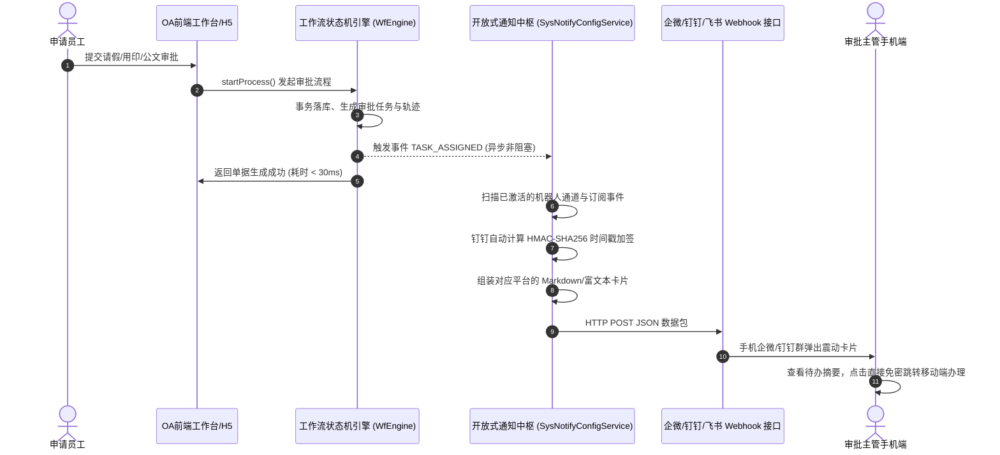

# 09 - 企微/钉钉/飞书 待办审批提醒机器人开放式集成方案与操作指南

## 1. 架构背景与设计哲学

在现代企业数字化协同场景中，**即时通讯（IM）工具（企业微信、钉钉、飞书）已经成为员工日常沟通与手机常驻的第一入口**。

传统老旧 OA 系统往往试图在自身系统内生搬硬套一套简易聊天窗口，但由于缺乏手机厂商底层的熄屏离线推送、音视频协议与多端漫游能力，往往沦为高成本且无人使用的“摆设功能”。

因此，新一代云枢 OA 协同平台（`oa-dev`）采用了**开放式、可插拔的群机器人 Webhook 中枢架构**：
* **业务在 OA，提醒在手机**：OA 系统负责强一致性的事务审批、合规留痕与毫米级纸质套打；企业微信/钉钉/飞书负责即时触达与手机震动提醒；
* **零代码二次侵入**：管理员仅需在界面点选并粘贴 Webhook 地址，即可秒级激活推送，不改动任何核心业务代码；
* **异步非阻塞**：基于 `@Async` 线程池与 Java 17 原生高并发 `HttpClient`，即便外网网络抖动或超时，也绝不影响 OA 主流程事务的毫秒级提交。

---

## 2. 开放式架构流转原理

---

## 3. 企业落地规划：全公司需要申请几个机器人？

> [!IMPORTANT]
> **核心原则：机器人是属于“群聊”的，而不是绑定“个人”的！**  
> 绝对不需要老板、各级领导、每位员工或每个部门都去分别申请机器人。机器人推送的消息卡片上会清晰注明：**申请人、单据类型、当前审批节点、指派审批人姓名**，群内人员一目了然。

### 3.1 方案对比与选型推荐

| 落地模式 | 推荐指数 | 机器人数量 | 适用企业规模 | 核心特点与群配置 |
| :--- | :---: | :---: | :--- | :--- |
| **标准模式（分流首选）** | ⭐⭐⭐⭐⭐ | **2 个** | **50 人以上大多数企业** | **动静分离**：全员群只接公文通知，管理层群专接审批待办，互不干扰打扰。 |
| **极简模式（起步首选）** | ⭐⭐⭐⭐ | **1 个** | 50 人以内扁平化团队 | 全公司只拉 1 个【审批待办通知群】，30 秒极速配好上线。 |
| **部门专属模式（特殊需要）** | ⭐⭐⭐ | 3 ~ 4 个 | 业务极度独立的集团分部 | 研发、销售、行政拥有独立群，按事件与部门做精细化路由。 |

---

### 3.2 🌟 推荐：标准模式（2 个机器人落地规范）

标准模式是业界最成熟、体验最佳的企业实践方案，通过“动静分离”彻底解决信息过载问题：

#### 机器人 ①：【全员公文通报助手】（面向全体员工）
* **挂载群聊**：公司【全员大群】或【企业通知公告群】（全体员工均在群内）。
* **OA 事件订阅**：**仅勾选【📢 公文通告发布 (`NOTICE_PUBLISHED`)】**，取消勾选待办事件。
* **业务效果**：
  - 每当行政部正式发布红头公文、集团放假通知或重大战略通告时，全员群即刻弹出带格式的公文卡片；
  - 员工点开即读，既保证了公文下发的全员触达率，又**绝对不会被日常琐碎的请假待办刷屏**。

#### 机器人 ②：【管理层审批待办助手】（面向决策审批人）
* **挂载群聊**：公司【管理层决策群】或【主管审批专项群】（仅老板、各部门主管、HR 负责人在此群）。
* **OA 事件订阅**：**勾选【🔔 待办到达 (`TASK_ASSIGNED`)】与【📋 流程办结 (`PROCESS_FINISHED`)】**。
* **业务效果**：
  - 任何员工提交请假、外出、用印申请或上级审批流转时，卡片秒级推送到主管群；
  - 卡片明确标注指派审批领导姓名（如 `指派审批：王经理`），主管手机立即收到震动，直接点击免密审批链接完成批复；
  - 流程办结或驳回时，自动同步最终结论与审计归档。

---

### 3.3 常见实施疑问解答 (FAQ)

> **问：领导如果问，能不能不发到群里，只发给我个人 1 对 1 私聊？**  
> **答**：
> 1. **当前阶段（群机器人）**：属于群广播形式，成本最低（0 元、免企业认证、无需公网备案域名），通过在群卡片中高亮指派人姓名达到督促效果；
> 2. **下一阶段（自建企业内部应用）**：若高管坚持需要 1 对 1 个人窗口私信卡片推送，需由企业微信/钉钉超级管理员在企微开放平台创建“企业内部自建应用（Agent）”，并通过员工 UserId 进行私聊发送（OA 系统架构已预留扩展接口）。

---

## 4. 数据库模型设计 (`oa_sys_notify_config`)

| 字段名 | 类型 | 约束 | 业务释义 |
| :--- | :--- | :---: | :--- |
| `id` | `BIGINT` | PK, AUTO_INCREMENT | 配置主键 ID |
| `platform` | `VARCHAR(32)` | NOT NULL | 目标协作平台（`WECHAT_WORK`、`DINGTALK`、`FEISHU`、`CUSTOM`） |
| `name` | `VARCHAR(64)` | NOT NULL | 机器人名称（如“全员公文通告助手”、“管理层待办群机器人”） |
| `webhook_url` | `VARCHAR(512)` | NOT NULL | 对应平台机器人的完整 Webhook 监听接口 |
| `secret_key` | `VARCHAR(256)` | NULL | 安全加签密钥（针对钉钉/飞书的安全设置） |
| `status` | `TINYINT` | NOT NULL DEFAULT 1 | 启用开关（`1` 正常启用，`0` 暂停停用） |
| `notify_events` | `VARCHAR(255)` | DEFAULT '...' | 订阅事件集合（逗号分隔） |
| `remark` | `VARCHAR(255)` | NULL | 备注说明 |
| `create_time` | `DATETIME` | CURRENT_TIMESTAMP | 创建时间 |
| `update_time` | `DATETIME` | ON UPDATE CURRENT_TIMESTAMP | 更新时间 |

---

## 5. 三大平台群机器人接入实操指南

### 5.1 企业微信群机器人配置（推荐，体验最佳）
1. 打开电脑端企业微信，进入目标内部群聊（如“全员大群”或“管理层待办群”）；
2. 点击右上角群设置 `...` -> 选择 **【添加群机器人】** -> 点击 **【新创机器人】**；
3. 为机器人起名（如“云枢协同OA协同待办助手”），点击确定；
4. 复制生成的 **Webhook 地址**（例如 `https://qyapi.weixin.qq.com/cgi-bin/webhook/send?key=xxxxxx`）；
5. 进入 OA 系统 -> 【组织与系统管理】 -> **【审批机器人通知】**（路由 `/system/notify`）；
6. 点击【接入新机器人】，选择平台为 **【企业微信】**，填入名称并粘贴 Webhook 地址，按需勾选订阅事件，保存生效；
7. 点击表格操作栏中的 **【测试发送】**，企业微信群内立即收到测试通知。

### 5.2 钉钉群自定义机器人配置（支持安全加签）
1. 打开电脑端钉钉，进入目标工作群 -> 点击右上角群设置 -> 选择 **【智能群助手】**；
2. 点击【添加机器人】 -> 选择最下方的 **【自定义（通过 Webhook 接入）】**；
3. 安全设置中勾选 **【加签】**（系统将生成一串 `SEC...` 开头的密钥）；
4. 复制机器人的 Webhook URL 以及对应的加签密钥；
5. 进入 OA 系统机器人配置面板，平台选择 **【钉钉】**，分别粘贴 Webhook URL 与加签密钥；
6. 后端服务在每次推送时会自动以当前毫秒时间戳 + 密钥计算 `HMAC-SHA256` 签名并拼装 URL 参数，确保传输绝对安全。

### 5.3 飞书群自定义机器人配置
1. 打开飞书群聊 -> 点击右上角设置 -> 【群机器人】 -> 【添加机器人】 -> 【自定义机器人】；
2. 复制生成的 Webhook 地址填入 OA 系统的飞书通道中即可。

---

## 6. 控制台自测与沙箱验证

为了让实施人员无需发起真实业务即可验证连通性，系统在前端提供了双重保障：
1. **手机端真实预览器**：配置弹窗右侧配备了 1:1 的手机消息流仿真面板，能实时预览当前配置在手机屏幕上的最终呈现形态；
2. **免业务打扰连通性测试**：点击表格中的【测试发送】按钮，后台将直接向该机器人 Webhook 投递一条专用握手数据包，并即时回传 HTTP 响应报文与错误详情。
