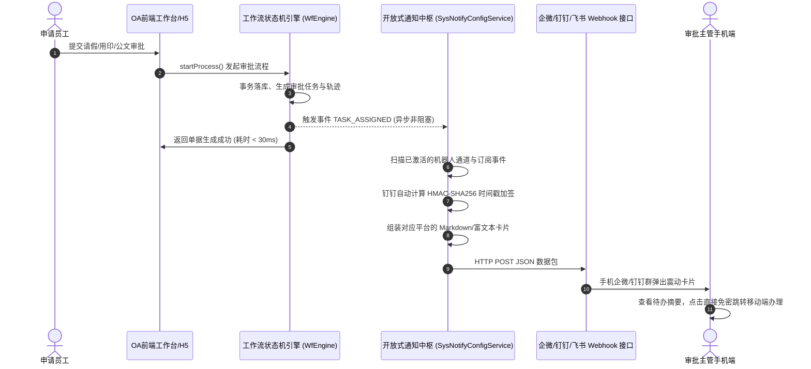

# 09 - 企微/钉钉/飞书 待办审批提醒机器人开放式集成方案与操作指南

## 1. 架构背景与设计哲学

在现代企业数字化协同场景中，**即时通讯（IM）工具（企业微信、钉钉、飞书）已经成为员工日常沟通与手机常驻的第一入口**。

传统老旧 OA 系统往往试图在自身系统内生搬硬套一套简易聊天窗口，但由于缺乏手机厂商底层的熄屏离线推送、音视频协议与多端漫游能力，往往沦为高成本且无人使用的“摆设功能”。

因此，新一代盛泰协同办公平台（`oa-dev`）采用了**开放式、可插拔的群机器人 Webhook 中枢架构**：
* **业务在 OA，提醒在手机**：OA 系统负责强一致性的事务审批、合规留痕与毫米级纸质套打；企业微信/钉钉/飞书负责即时触达与手机震动提醒；
* **零代码二次侵入**：管理员仅需在界面点选并粘贴 Webhook 地址，即可秒级激活推送，不改动任何核心业务代码；
* **异步非阻塞**：基于 `@Async` 线程池与 Java 17 原生高并发 `HttpClient`，即便外网网络抖动或超时，也绝不影响 OA 主流程事务的毫秒级提交。

---

## 2. 开放式架构流转原理

---

## 3. 数据库模型设计 (`oa_sys_notify_config`)

| 字段名 | 类型 | 约束 | 业务释义 |
| :--- | :--- | :---: | :--- |
| `id` | `BIGINT` | PK, AUTO_INCREMENT | 配置主键 ID |
| `platform` | `VARCHAR(32)` | NOT NULL | 目标协作平台（`WECHAT_WORK`、`DINGTALK`、`FEISHU`、`CUSTOM`） |
| `name` | `VARCHAR(64)` | NOT NULL | 机器人名称（如“集团审批中心企微提醒群”） |
| `webhook_url` | `VARCHAR(512)` | NOT NULL | 对应平台机器人的完整 Webhook 监听接口 |
| `secret_key` | `VARCHAR(256)` | NULL | 安全加签密钥（针对钉钉/飞书的安全设置） |
| `status` | `TINYINT` | NOT NULL DEFAULT 1 | 启用开关（`1` 正常启用，`0` 暂停停用） |
| `notify_events` | `VARCHAR(255)` | DEFAULT '...' | 订阅事件集合（逗号分隔） |
| `remark` | `VARCHAR(255)` | NULL | 备注说明 |
| `create_time` | `DATETIME` | CURRENT_TIMESTAMP | 创建时间 |
| `update_time` | `DATETIME` | ON UPDATE CURRENT_TIMESTAMP | 更新时间 |

---

## 4. 三大平台群机器人接入实操指南

### 4.1 企业微信群机器人配置（推荐，体验最佳）
1. 打开电脑端企业微信，进入任意需要接收审批提醒的内部群聊；
2. 点击右上角群设置 `...` -> 选择 **【添加群机器人】** -> 点击 **【新创机器人】**；
3. 为机器人起名（如“盛泰OA协同待办助手”），点击确定；
4. 复制生成的 **Webhook 地址**（例如 `https://qyapi.weixin.qq.com/cgi-bin/webhook/send?key=xxxxxx`）；
5. 进入 OA 系统 -> 【组织与系统管理】 -> **【消息提醒机器人】**（路由 `/system/notify`）；
6. 点击【接入新机器人】，选择平台为 **【企业微信】**，填入名称并粘贴 Webhook 地址，保存生效；
7. 点击表格操作栏中的 **【发送测试卡片】**，企业微信群内立即收到测试通知。

### 4.2 钉钉群自定义机器人配置（支持安全加签）
1. 打开电脑端钉钉，进入目标工作群 -> 点击右上角群设置 -> 选择 **【智能群助手】**；
2. 点击【添加机器人】 -> 选择最下方的 **【自定义（通过 Webhook 接入）】**；
3. 安全设置中勾选 **【加签】**（系统将生成一串 `SEC...` 开头的密钥）；
4. 复制机器人的 Webhook URL 以及对应的加签密钥；
5. 进入 OA 系统机器人配置面板，平台选择 **【钉钉】**，分别粘贴 Webhook URL 与加签密钥；
6. 后端服务在每次推送时会自动以当前毫秒时间戳 + 密钥计算 `HMAC-SHA256` 签名并拼装 URL 参数，确保传输绝对安全。

### 4.3 飞书群自定义机器人配置
1. 打开飞书群聊 -> 点击右上角设置 -> 【群机器人】 -> 【添加机器人】 -> 【自定义机器人】；
2. 复制生成的 Webhook 地址填入 OA 系统的飞书通道中即可。

---

## 5. 已支持的系统自动化事件列表

| 事件代码 (`notify_events`) | 触发时机 | 推送卡片内容要点 |
| :--- | :--- | :--- |
| `TASK_ASSIGNED` | 员工发起请假、用印、公文、外勤、加班等流程，或流转至下一级审批人，或被他人加签时 | 单据名称、流程分类、申请人员姓名与部门、当前审批环节、到达时间戳、免密审批链接提示。 |
| `PROCESS_FINISHED` | 审批流程全部流转完毕（最终同意办结），或任一环节被驳回终止时 | 单据名称、发起人、最终审批结论（【审批通过·办结】/【审批驳回】）、归档留痕提示。 |
| `NOTICE_PUBLISHED` | 管理员或发文部门在公文大厅正式发布全员通告、决议文件时 | 红头公文标题、通告类别、发布单位与发布时间，提醒全体员工及时签收查阅。 |

---

## 6. 控制台自测与沙箱验证

为了让实施人员无需发起真实业务即可验证连通性，系统在前端提供了双重保障：
1. **手机端真实预览器**：配置弹窗右侧配备了 1:1 的手机消息流仿真面板，能实时预览当前配置在手机屏幕上的最终呈现形态；
2. **免业务打扰连通性测试**：点击表格中的【发送测试卡片】按钮，后台将直接向该机器人 Webhook 投递一条专用握手数据包，并即时回传 HTTP 响应报文与错误详情。
