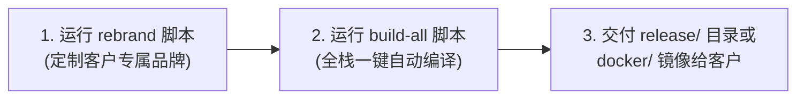

# 11 - 启航协同平台 · 客户私有化白标定制与 OEM 一键品牌重塑实操指南

> **文档编号**：`11-white-label-rebranding-guide.md`  
> **基准品牌**：启航 OA 协同平台（Qihang OA Suite）  
> **适用场景**：面向不同政企客户、民营集团、分销渠道商的私有化交付、OEM 贴牌与白标定制上线  
> **交付工具**：`oa-dev/scripts/rebrand.sh`、`rebrand.bat`、`rebrand.py`

---

## 1. 背景与商业价值

在企业级管理软件（OA / BPM / ERP）的商业化交付与私有化实施过程中，**“软件品牌白标定制（White-Label / OEM）”** 是一项极其核心的商业交付能力：
1. **统一客户品牌认同**：政企与集团客户通常要求系统内显示的全部名称、公司全称、公文红头、印章抬头与通知短信必须 100% 呈现客户自身的企业标识，绝不允许出现第三方开发团队或历史原厂的名字；
2. **渠道代理与贴牌合作**：渠道分销商或 ISV 伙伴在向最终用户交付时，需要以自身软件品牌或独立品牌进行宣传与定价；
3. **彻底抹除开发期痕迹**：系统在演进过程中经历过历史版本（如早期的“盛泰”），通过白标工程化体系，实现了开发源码痕迹的彻底清零，并确立了全新的官方旗舰品牌——**“启航（Qihang）”**。

---

## 2. 官方标准商业规范：以“启航”为例

系统当前已将 **“启航（Qihang）”** 作为标准产品基线，其在系统各维度的具体映射规范如下表所示：

| 维度要素 | “启航”标准范例 | 在系统中的生效位置 |
| :--- | :--- | :--- |
| **系统显示名称** | **启航 OA 协同平台** | 登录页面大标题、左侧侧边栏顶部 Logo、浏览器标签页 Title、全景服务大厅大门横幅 |
| **公司主体全称** | **启航智慧协同科技有限公司** | 高保真纸质打印表头（请假单、考勤补卡表、借阅单、用印表）、工资条明细、对外合作单位展示 |
| **品牌与组织简称** | **启航协同** / **启航科技** | 移动端 H5 顶部部门标签、系统通讯录顶级组织、系统运维日志前缀 |
| **红头公文头** | **启航智慧协同集团有限公司文件** | 红头公文拟文大厅、公文红头套打发文红字、公文审批归档表 |
| **发文字号前缀** | **启航发〔2026〕XX号** | 公文编号自动生成器（`RedheadDocDTO`、数据库 `doc_no` 约束） |
| **防伪电子印章** | **启航智慧协同科技有限公司** | 用印审批预览、防伪水印底图、五角星行政防伪公章 |
| **打卡考勤基准地**| **北京市海淀区中关村南大街启航大厦** | 考勤打卡定位基准、外勤报备地址建议、移动端 GPS 电子围栏 |
| **财务核算单位** | **启航财务与薪酬中心** | 工资单底部核算部门、报销核算财务抬头 |

---

## 3. 白标定制自动化工具链架构

为了杜绝人工在成百上千个代码文件中手工搜索替换导致的漏改、错改、编码混乱或编译报错，系统在 `oa-dev/scripts/` 目录下内置了全自动化的白标重命名工具链：

```text
oa-dev/scripts/
├── rebrand.sh    # Linux / macOS / Git Bash 环境运行脚本（支持交互与参数）
├── rebrand.bat   # Windows 桌面环境一键双击批处理脚本
└── rebrand.py    # 跨平台高精度重塑替换核心引擎（内置 UTF-8 编码防御与历史词彻底抹除机制）
```

### 3.1 工具覆盖的关键资产矩阵（38+ 处关键系统文件）
- **前端视图与打印组件**：
  - `oa-frontend/src/views/login/index.vue`（登录界面）
  - `oa-frontend/src/layouts/BasicLayout.vue`（PC 端主布局 Logo）
  - `oa-frontend/src/layouts/MobileLayout.vue`（移动端 H5 顶部）
  - `oa-frontend/src/router/index.ts`（全局路由标题拦截器）
  - `oa-frontend/src/components/print/ElectronicStamp.vue`（防伪电子印章）
  - `oa-frontend/src/views/business/*Print.vue`（高保真打印模板集合：用印、考勤、请假、借阅、红头）
- **后端模型与数据库脚本**：
  - `oa-backend/src/main/resources/sql/schema.sql`
  - `oa-backend/src/main/java/com/graddu/oa/module/business/administrative/dto/RedheadDocDTO.java`
  - `oa-dev/sql/schema.sql`、`oa-dev/release/sql/schema.sql`
- **构建与部署脚本**：
  - `build-all.bat` / `build-all.sh`
  - `docker/start.bat` / `docker/start.sh`
  - `release/bin/start-backend.bat` / `start-backend.sh`
  - `release/config/application-prod.yml`

---

## 4. 白标一键定制实操教程

### 4.1 方式一：交互式模式（适合实施人员现场配置）

无论在 Windows 还是 Linux，直接运行脚本，脚本会显示清晰的配置引导：

#### Windows 环境：
直接双击 `oa-dev\scripts\rebrand.bat`，或在 PowerShell / CMD 中执行：
```powershell
cd E:\OA\oa-suite\oa-dev\scripts
.\rebrand.bat
```

#### Linux / macOS / Git Bash 环境：
```bash
cd oa-dev/scripts
bash rebrand.sh
```

#### 交互式输入界面示例：
```text
=================================================================
  🚀 企业协同办公系统 · 客户白标品牌一键定制工具
=================================================================

请输入您想要为客户定制的品牌信息（直接回车使用默认“启航”基准值）:
 [1] 系统显示名称 (默认: 启航 OA 协同平台): 华润协同办公工作台
 [2] 客户公司全称 (默认: 启航智慧协同科技有限公司): 华润实业控股集团有限公司
 [3] 客户企业简称 (默认: 启航协同): 华润协同
 [4] 红头公文字号代字 (默认: 启航发): 华润发

-----------------------------------------------------------------
 即将执行品牌全量定制：
   - 系统名称   : 华润协同办公工作台
   - 公司全称   : 华润实业控股集团有限公司
   - 企业简称   : 华润协同
   - 公文字号   : 华润发〔2026〕XX号
   - 目标工作区 : E:\OA\oa-suite\oa-dev
-----------------------------------------------------------------
 [✓] 已重塑: oa-frontend\src\layouts\BasicLayout.vue
 [✓] 已重塑: oa-frontend\src\views\login\index.vue
 ...
 🎉 品牌重塑执行完毕！共扫描 253 个文件，成功重塑 38 个文件。
```

---

### 4.2 方式二：命令行静默模式（适合 CI/CD 自动化构建）

对于采用 Jenkins、GitLab CI 或自动化打包流水线的场景，可直接传入 4 个定位参数，1 秒内完成无头全量替换：

```bash
# 命令格式：
# bash rebrand.sh "系统名称" "客户公司全称" "企业简称" "公文字号代字"

# 示例：为“中铁建设”客户定制
bash oa-dev/scripts/rebrand.sh "中铁智慧协同办公平台" "中铁建设工程集团有限公司" "中铁建设" "中铁发"
```

---

## 5. 定制后生成最终生产交付包的闭环流程

当您通过脚本为客户完成品牌定制后，只需执行以下 2 步，即可交付给客户：



1. **执行重塑**：
   运行 `rebrand.bat`（或 `rebrand.sh`），填入客户品牌参数；
2. **一键全栈构建**：
   - Windows：双击 `oa-dev\build-all.bat`；
   - Linux：执行 `bash oa-dev/build-all.sh`；
   - 脚本将自动完成前端 Vite 压缩构建、后端 Fat JAR 打包，并将产物汇总至 `oa-dev/release/`；
3. **交付成果验证**：
   - 启动服务后打开登录页面，Logo、Title、红头与用印印章已全部完美呈现客户自身品牌；
   - 源码中不会透露任何开发期原厂痕迹，完全符合企业级私有化验收标准。

---

## 6. 注意事项与常见 FAQ

> **问：多次执行 `rebrand` 脚本会导致代码混乱吗？**  
> **答**：不会。替换引擎基于精确词干拓扑与全词匹配，支持无限次反复重命名（例如今天定制为“客户A”，明天可以直接再执行定制为“客户B”）。

> **问：改完之后浏览器页面没有变怎么回事？**  
> **答**：
> 1. 如果是在开发模式（Vite dev）下，直接在浏览器中按下 **`Ctrl + F5` 强制刷新** 即可清除浏览器前端缓存；
> 2. 如果是生产模式，请重新运行 `build-all.bat` 更新 `release/dist` 静态资源包。
