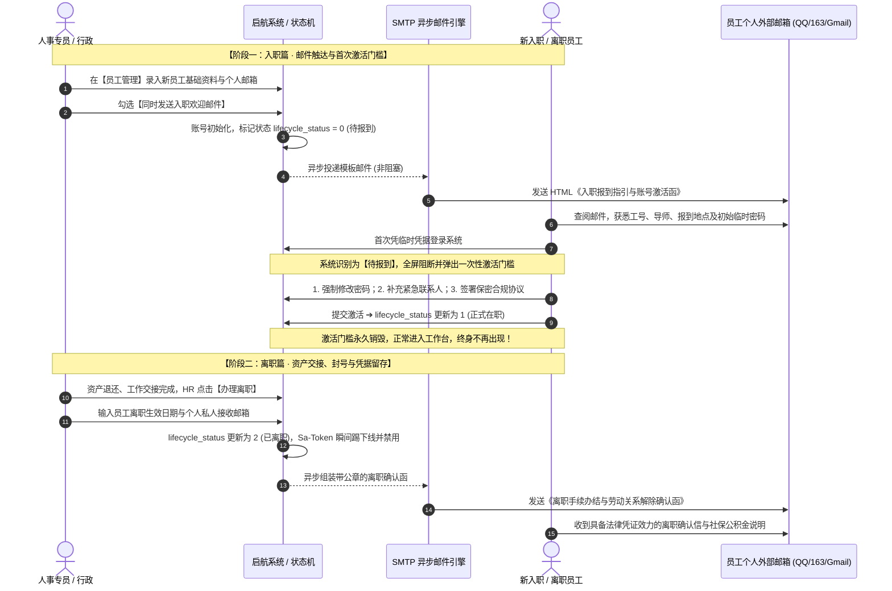

# 12 - 启航协同平台 · 员工入职欢迎与离职办结全生命周期架构归档方案

> **文档编号**：`12-employee-lifecycle-onboarding-offboarding-blueprint.md`  
> **编制日期**：2026-10-28  
> **当前状态**：**【已完成业务建模与架构方案设计 · 待企业邮件服务器配置后启动开发】（Standby / Archived）**  
> **前置依赖**：企业级 SMTP 发信服务器账号（腾讯企业邮 / 网易企业邮 / 阿里邮箱 / 私有化 Postfix 服务）

---

## 1. 方案背景与设计初衷

在企业人事管理（HRM）的实际运转中，员工入职与离职是两个极具仪式感、且关系到法律合规与组织信息安全的核心里程碑：
1. **入职场景（Onboarding）**：
   - 新员工入职的第一触点是在**外部个人邮箱**（入职前其尚无内网环境与系统访问习惯）；
   - 必须通过一份正规的《入职欢迎与报到指引信》下发初始账号、工号、报到指引、导师联系方式与所需携带材料；
   - 首次登录系统时触发**一次性激活门槛**（修改弱密码、签署保密协议、核对信息），**完成即彻底销毁，绝不在工作台留存任何多余入口**。
2. **离职场景（Offboarding）**：
   - 离职是企业资产安全与劳动纠纷防范的敏感环节；
   - 员工办结离职并退还资产后，系统必须**瞬间阻断登录会话（Sa-Token 踢下线）**；
   - 自动向离职员工的**个人外部邮箱**发送具备法律效力的《离职手续办结确认函》（附带电子离职证明、社保公积金停缴月份说明与无借款证明）。

---

## 2. 全生命周期时序与流转架构



---

## 3. 基础设施就绪前置清单 (Infrastructure Prerequisite)

待后续企业邮件服务器采购或配置到位后，只需在 `oa-backend` 中配置以下外部化参数即可激活：

### 3.1 后端依赖引入
在 `oa-backend/pom.xml` 中引入官方邮件起步依赖：
```xml
<dependency>
    <groupId>org.springframework.boot</groupId>
    <artifactId>spring-boot-starter-mail</artifactId>
</dependency>
```

### 3.2 配置文件规范 (`application-prod.yml`)
```yaml
spring:
  mail:
    host: smtp.exmail.qq.com       # 企业邮箱 SMTP 服务器地址
    port: 465                      # SSL 端口 (通常为 465 或 587)
    username: notice@qihang.com    # 系统发件账号
    password: YOUR_SMTP_AUTH_CODE  # 发件授权码 (非邮箱登录明文密码)
    protocol: smtps
    default-encoding: UTF-8
    properties:
      mail:
        smtp:
          auth: true
          ssl:
            enable: true
          timeout: 5000
          connectiontimeout: 5000
```

---

## 4. 数据库生命周期模型预研

在 `oa_sys_user` 表结构中预留生命周期状态字段：

```sql
-- 员工全生命周期状态扩展
ALTER TABLE `oa_sys_user` 
  ADD COLUMN `lifecycle_status` TINYINT NOT NULL DEFAULT 1 COMMENT '生命周期: 0-待入职激活, 1-正式在职, 2-已离职归档',
  ADD COLUMN `personal_email` VARCHAR(128) DEFAULT NULL COMMENT '员工私人外部邮箱 (用于接收离职确认函)',
  ADD COLUMN `onboard_date` DATE DEFAULT NULL COMMENT '正式入职报到日期',
  ADD COLUMN `resign_date` DATE DEFAULT NULL COMMENT '离职生效办结日期';
```

---

## 5. 核心邮件模板规范原型 (HTML Mail Prototype)

### 5.1 模板 A：《🎉 欢迎加入启航协同大家庭 —— 入职报到指引与账号激活信》
* **发件人**：`启航智慧协同组织与人才发展中心 <hr@qihang.com>`
* **收件人**：新员工个人邮箱
* **邮件正文要点**：
  ```text
  尊敬的 [张三] 同学：
  您好！恭喜您正式通过考评，加入启航智慧协同科技有限公司！
  我们诚挚邀请您于 2026年11月01日 09:00 前往公司报到。

  【您的专属入职档案】
  - 录用部门：技术中心 / 研发一部
  - 职务岗位：Java 后端开发工程师
  - 员工工号：QH-20261101
  - 带教导师：李组长 (内线: 8081)

  【报到携带材料清单】
  1. 身份证原件及正反面复印件 2 份；
  2. 原单位离职证明原件（应届毕业生带三方协议）；
  3. 近 3 个月内常规入职体检合格报告；
  4. 一寸白底免冠证件照 2 张（制作工卡使用）。

  【协同办公系统初始登录凭证】
  - 平台地址：https://oa.qihang.com
  - 登录账号：zhangsan
  - 初始临时密码：Qh#2026Init (请于首次登录时根据系统提示强制重置)

  千帆竞发，勇立潮头。期待与您携手开启全新的协同征程！
  ```

---

### 5.2 模板 B：《📋 启航协同平台 · 离职手续办结与劳动关系解除确认函》
* **发件人**：`启航智慧协同人力资源与行政部 <notice@qihang.com>`
* **收件人**：离职员工私人外部邮箱
* **法律与合规要点**：
  ```text
  尊敬的 [李四] 先生/女士：
  您在 [启航智慧协同科技有限公司] 的全部离职移交手续已于 2026年10月31日 确认办结。

  【交接核验结论】
  1. 工作交接：已与交接人 [王主管] 完成工作档案与在手业务全面移交；
  2. IT 与资产清零：已退还配置之 MacBook Pro 电脑、门禁工卡及办公设备；
  3. 财务与报销账目：借款与差旅报销款项已全额结清，无遗留财务债权债务；
  4. 权限与账号：系统访问权限自 2026-10-31 18:00 起正式终止回收。

  【社保与证明附件】
  - 本公司为您缴纳法定社会保险及住房公积金至 2026 年 10 月止；
  - 随信附带盖有公司电子公章之《解除劳动合同证明书》（PDF 格式），具有完全法律凭证效力。

  感谢您在任职期间为启航所做出的辛勤努力与贡献，衷心祝愿您在未来的职业道路上前程锦绣、万事顺意！
  ```

---

## 6. 归档结论与后续接入指引

1. **当前阶段**：
   - 保持主干代码与核心工作台的绝对纯净与高频调度的敏捷性，避免半成品上屏干扰；
   - 本设计规范作为 Phase 3 人事服务治理的核心蓝图完整归档。
2. **后续启动实施路径**：
   - 企业采购/申请获得 SMTP 发件账号后；
   - 依据本规范第 3 节配置连接池，并在【员工管理】界面启用“发送邮件”的勾选框，预计 0.5 个工作日内即可全链路无缝上线！
